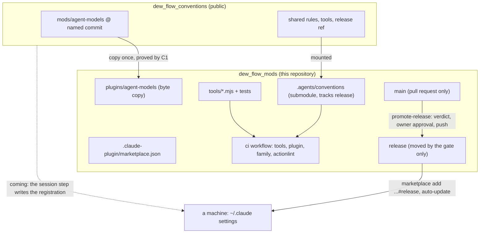

# Architecture

`dew_flow_mods` is a Claude Code plugin marketplace (`.claude-plugin/marketplace.json`, name `dew-flow-mods`) that serves
one plugin today, `agent-models`, a copy of the mod that lives in `dew_flow_conventions`. The repository has no service
and no runtime of its own: it holds the catalog, the plugin folder, a few node tools that prove the copy, and CI.

## The two refs

`main` is written by pull request only (ruleset `main`). `release` is the one ref that machines load, and it moves only
through `.github/workflows/promote-release.yml`: the owner dispatches it against `main` with a sha; the job `verdict` (no
secret) judges the commit and prints the compare URL; the job `push` (environment `release`, the owner approves) judges it
again and pushes `release` and the tag `<plugin>--v<version>` in one atomic push with the deploy key. The judgement is the
green `ci` push run of that exact sha, forward only, a layout gate, a version gate and a free tag. Rulesets let only the
deploy key create or move `release` and create a version tag, and let nobody rewind or delete either. The rules and
the settings are data with a read-back: see [module_marketplace.md](module_marketplace.md). Nothing is released until the
settings are applied and the first promotion runs; that promotion makes the tag `agent-models--v1.6.0`, and the copy
proof reads it once `plugin.json` goes above 1.6.0.

What is on `release` runs on every machine with the owner's permissions and outside any sandbox: a change under
`plugins/` needs a higher `plugin.json` version, and a plugin folder holds no `package.json`, lockfile or link that
leaves it.

## How a machine gets the mod

Installed by hand today: `claude plugin marketplace add https://github.com/oleksandrdubyna88/dew_flow_mods.git#release`
and `claude plugin install agent-models@dew-flow-mods` (HTTPS: SSH to GitHub does not work from every machine). The
engine's own auto-update then follows `release`. Not built yet: the registration step in `dew_flow_conventions`, which
writes the marketplace entry and `enabledPlugins` into user settings at session start and retires the old copy under
`~/.claude/mods`.

## Interaction with dew_flow_conventions

| What | Direction | Status |
|---|---|---|
| The copy source: `mods/agent-models` at the commit named in `tools/copy-proof.mjs` and `ci.yml` | conventions to this repository, once, proved by C1 | built |
| The family mount: `.agents/conventions` (submodule on its `release` branch), the Claude adapter in `.claude/` as byte copies, the three family checks | conventions to this repository, continuous | built |
| The registration step: conventions' session start installs the marketplace entry on every machine | conventions writes the settings that point at this repository | coming (the conventions side of the plan, `todo/PLAN_dew_flow_mods.md` § D there) |
| The next mod version (R4 fixed, 1.6.1) | built here, not in conventions | coming |

The old installer in conventions (`mods/agent-models` plus the nine consumers' pins) runs as before until the
registration step retires it; this repository does not touch it.

## CI

One workflow `ci` (the release gate reads the push run of an exact sha on `main`; the workflow cancels a superseded run, and
a cancelled run is not green) on `pull_request` and `push` to `main`, never `pull_request_target`, a read-only token, every
action pinned to a full sha, `npm ci --ignore-scripts`, no credential. Four jobs: tools (the tools tests, the layout gate, the
copy proof), plugin, family, actionlint. `pr-title.yml` checks the pull request title. `promote-release.yml` is dispatch-only
and is the one workflow with an environment and a secret. See [module_tests.md](module_tests.md).
SonarCloud is not set up (a follow-up for the owner, `todo/README.md`).
