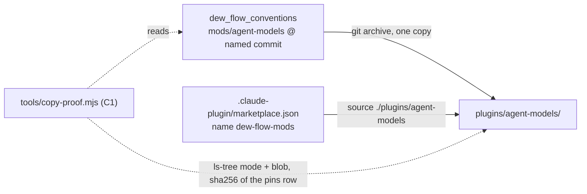

# Module: the marketplace and the copy

Purpose: serve the `agent-models` mod as a Claude Code plugin marketplace, and prove that the served folder is the
folder that was reviewed in `dew_flow_conventions`.

## Entities

| Thing | Where | Rule |
|---|---|---|
| Catalog | `.claude-plugin/marketplace.json` | name `dew-flow-mods`; one entry per plugin with `name`, `source`, `description` only |
| The mod | `plugins/agent-models/` | a byte copy of `mods/agent-models` of the conventions commit named in `tools/copy-proof.mjs` (`DEFAULT_COMMIT`) and in `ci.yml` (`CONVENTIONS_COPY_SHA`); not edited without a higher `plugin.json` version |
| Copy proof, C1 | `tools/copy-proof.mjs` | `git ls-tree -r` of this repository against the conventions tree, entry by entry: mode and blob id; plus the sha256 of every key of the `1.6.0` row of `tools/agent-models-pins.json` at that commit. A symlink, a mode change, an extra or missing file, a force-added file under `.claude-plugin/types/`, a row key in neither tree: each is a finding. Prints the number of keys hashed |
| Type baseline | `tools/type-baseline.mjs`, `tools/type-baseline.json` | the engine's TypeScript findings of the mod, keyed by file and message with a count; new or gone findings are red |
| Binary finder | `tools/claude-bin.mjs` | `npm ci --ignore-scripts` leaves only the stub of the CLI; this prints the path of the native binary or exits 1 with the reason |

## Flows

1. **Copy.** `git -C <conventions> archive <commit> mods/agent-models | tar -x --strip-components=2 -C plugins/agent-models`.
2. **Proof (CI job `mods · tools`).** The job fetches the conventions commit into the mounted submodule, fetches the tag
   `agent-models--v1.6.0` of this repository (absent before the first promotion), and runs `node tools/copy-proof.mjs`.
   While `plugin.json` is 1.6.0 the folder at `HEAD` (and on disk) is compared. Above 1.6.0 the folder has moved on, and the
   same proofs are made on the tree of the tag; an absent tag is red and names the fetch command.
3. **Validate (CI job `mods · plugin`).** `claude plugin validate .`, `claude plugin validate --json plugins/agent-models`
   and the type baseline, then `claude plugin test plugins/agent-models`, all with the pinned CLI and no login.

## External dependencies

`dew_flow_conventions` (public): the copy source, the pins table, and the mounted family rules at `.agents/conventions`.
`@anthropic-ai/claude-code` 2.1.330, exact, a devDependency only. No plugin installs a dependency.

## What it does not do

It does not promote anything: the `release` ref, the version and layout gates and the tag per version are story 2.2 of
the conventions plan `todo/PLAN_dew_flow_mods_E2_gate.md`. See [architecture.md](architecture.md).
