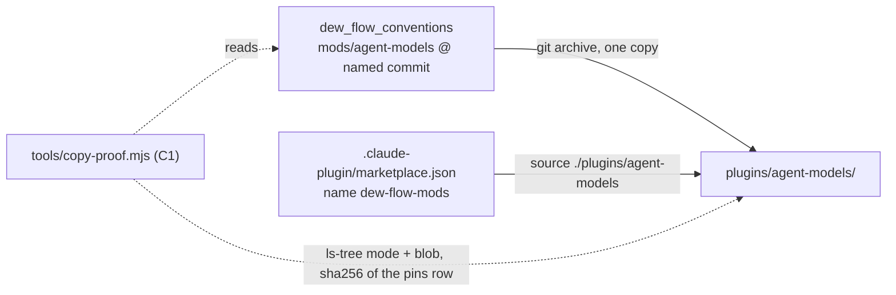

# Module: the marketplace and the copy

Purpose: serve the `agent-models` mod as a Claude Code plugin marketplace, and prove that the served folder is the
folder that was reviewed in `dew_flow_conventions`.

## Entities

| Thing | Where | Rule |
|---|---|---|
| Catalog | `.claude-plugin/marketplace.json` | name `dew-flow-mods`; one entry per plugin with `name`, `source`, `description` only |
| The mod | `plugins/agent-models/` | a byte copy of `mods/agent-models` of the conventions commit named in `tools/copy-proof.mjs` (`DEFAULT_COMMIT`) and in `ci.yml` (`CONVENTIONS_COPY_SHA`); not edited without a higher `plugin.json` version |
| Copy proof, C1 | `tools/copy-proof.mjs` | `git ls-tree -r` of this repository against the conventions tree, entry by entry: mode and blob id; plus the sha256 of every key of the `1.6.0` row of `tools/agent-models-pins.json` at that commit. A symlink, a mode change, an extra or missing file, a force-added file under `.claude-plugin/types/`, a row key in neither tree: each is a finding. Prints the number of keys hashed |
| Type baseline | `tools/type-baseline.mjs`, `tools/type-baseline.json` | the engine's TypeScript findings of the mod, keyed by file and message with a count; new or gone findings are red |
| Binary finder | `tools/claude-bin.mjs` | `npm ci --ignore-scripts` leaves only the stub of the CLI; this prints the path of the native binary or exits 1 with the reason |

## Flows

1. **Copy.** `git -C <conventions> archive <commit> mods/agent-models | tar -x --strip-components=2 -C plugins/agent-models`.
2. **Proof (CI job `mods · tools`).** The job fetches the conventions commit into the mounted submodule, fetches the tag
   `agent-models--v1.6.0` of this repository (absent before the first promotion), and runs `node tools/copy-proof.mjs`.
   While `plugin.json` is 1.6.0 the folder at `HEAD` (and on disk) is compared. Above 1.6.0 the folder has moved on, and the
   same proofs are made on the tree of the tag; an absent tag is red and names the fetch command.
3. **Validate (CI job `mods · plugin`).** `claude plugin validate .`, `claude plugin validate --json plugins/agent-models`
   and the type baseline, then `claude plugin test plugins/agent-models`, all with the pinned CLI and no login.

## External dependencies

`dew_flow_conventions` (public): the copy source, the pins table, and the mounted family rules at `.agents/conventions`.
`@anthropic-ai/claude-code` 2.1.330, exact, a devDependency only. No plugin installs a dependency.

## The release gate (story 2.2)

`release` moves only by `.github/workflows/promote-release.yml`, which runs `tools/promote-release.mjs` (a copy of the
tool of the same name in dew_flow_conventions `69adc1e`, with four differences) and `tools/mods-gate.mjs`.

| Question | Answer that promotes | Refusal |
|---|---|---|
| the sha | 40 hex, reachable from `origin/main` | `NOT A SHA`, `NOT ON MAIN` |
| ci | every `ci` run of that exact sha with event `push` on `main` is completed and `success`; a run of another event or branch is no evidence, a cancelled run is not green | `NO CI RUN`, `CI NOT FINISHED`, `CI NOT GREEN` |
| direction | `release` is an ancestor of the sha | `NOT A FORWARD MOVE` |
| layout | the catalog has the top-level keys `name` (`dew-flow-mods`), `owner`, `metadata` (only `description`), `plugins`; an entry is exactly `name`, `source`, `description`; `source` is the string `./plugins/<name>`; the folders under `plugins/` and the entries are one set; the manifest name is the entry name and its version is `major.minor.patch`; no `package.json`, lockfile, `node_modules`, symlink or gitlink under `plugins/`; a plugin `release` has is still there | `LAYOUT`, every finding as `path: reason` |
| version | a plugin folder that differs from `release` (a test file counts) has a higher version, compared as three numbers | `VERSION NOT RAISED` |
| tag | `<plugin>--v<version>` of a raised version does not exist at another sha | `TAG EXISTS` |

The push is one `git push --atomic origin <sha>:refs/heads/release <sha>:refs/tags/<plugin>--v<version>`, a lightweight
tag, with no `--force`; the tool then reads every pushed ref back. A promotion that changes nothing under `plugins/`
creates no tag (`plugins: none changed`). `--dry-run` judges everything and prints the compare URL, the plugins line and
which commit the gate runs at. `node tools/mods-gate.mjs [rev]` is the layout gate alone, a step of the `mods · tools` job.

**Settings as data** (`.github/rulesets/*.json`, `.github/settings.json`, read back by `.github/scripts/repo-settings.mjs`):

| Ruleset | Ref | Rules | Bypass |
|---|---|---|---|
| `main` | `refs/heads/main` | no delete, no force push, linear history, squash only, resolved threads, the five checks as posted by the Actions app (strict) | none |
| `release-moves` | `refs/heads/release` | creation, update | the deploy key |
| `release-fixed` | `refs/heads/release` | deletion, non-fast-forward | none |
| `tags-create` | `refs/tags/<plugin>--v*` | creation | the deploy key |
| `tags-fixed` | `refs/tags/<plugin>--v*` | update, deletion | none |

Two rulesets for each ref because a bypass covers every rule of its ruleset: with one, the key could also rewind and
delete. The `release` environment has the owner as its one required reviewer, `main` as its one deployment branch, one
secret `RELEASE_DEPLOY_KEY` (never a repository secret), and administrators may not bypass it. The workflow job `push` is the only
place that secret is read.

**The order, with the owner's login:** after the pull request merges, `node .github/scripts/repo-settings.mjs --apply`
(preview with `--apply --dry-run`); then, in the owner's OWN terminal (a key an agent session made is a key that session
could keep): `ssh-keygen -q -t ed25519 -N '' -C release -f "$d/k"`, `gh repo deploy-key add "$d/k.pub" --repo
oleksandrdubyna88/dew_flow_mods --allow-write --title release-promotion`, `gh secret set RELEASE_DEPLOY_KEY --repo
oleksandrdubyna88/dew_flow_mods --env release < "$d/k"`, print the public line, delete the folder. A pull request writes
that line into `.github/settings.json`; the read-back then exits 0. The API shows no `can_admins_bypass`: the owner
unticks "Allow administrators to bypass configured protection rules" on the environment by hand and the record says so.

**Not built (decided 2026-11-23):** an agent identity (a GitHub App with a token tool). The shared `gh` login stays, and
the click on the approval is a procedure. The observations on GitHub (a hand push to `release`, a fork pull request) are
recorded in `research/RESULTS_release_gate.md` when they are run.
